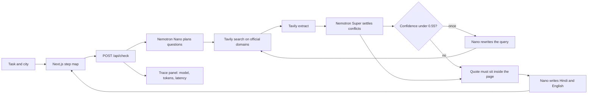

# Sarkari Speedrun

Type an Indian government task and a city — `renew passport, Patiala` — and get a step map: ordered steps, documents, fees, the office or portal, processing time, and a recent-change flag where the quoted line itself says something changed.

Every item on the map cites an official page and a line copied from that page. If the line is not in the retrieved text, the item is dropped. A rupee amount that is not in the quote is dropped too.

It is built for the [Nebius x NVIDIA Global AI Hackathon](https://nebiusglobalaihackathon.devpost.com). Planning, conflict-settling, and the bilingual checklist are NVIDIA Nemotron models on [Nebius Token Factory](https://tokenfactory.nebius.com/). [Tavily](https://tavily.com/) is the evidence step.

**Live demo:** [https://sarkari-speedrun.vercel.app](https://sarkari-speedrun.vercel.app)

## One-command run

```bash
npm install && npm run demo
```

Open [http://127.0.0.1:41731](http://127.0.0.1:41731). With no API keys the five cached demos still run. Other tasks stay an empty map.

```bash
npm test
npm run eval
```

`npm run eval` prints a small accuracy table. It is labelled as a small sample, not a benchmark. In mock mode that table only checks that the cached demos still carry the hand-copied official quotes. It is not a live Nemotron score.

## Live results (Oct 26, 2026)

Seven live runs on Token Factory and Tavily, one each, no retries:

| Task | Cited items kept | Sites cited | Time |
| --- | --- | --- | --- |
| renew passport, Patiala | 2 | passportindia.gov.in, mea.gov.in | 19 s |
| link PAN with Aadhaar, Ludhiana | 2 | incometax.gov.in, incometaxindia.gov.in | 9 s |
| renew driving licence, Amritsar | 2 | parivahan.gov.in | 17 s |
| change address on voter ID, Patiala | 1 | eci.gov.in | 12 s |
| residence certificate, Patiala | 4 | eservices.punjab.gov.in, rcms.punjab.gov.in | 20 s |
| apply for birth certificate, Jalandhar (new) | 4 | crsorgi.gov.in | 24 s |
| get income certificate, Mohali (new) | 0 | none | 12 s |

Nemotron Super proposed 20 items across these runs. 15 survived the quote check. The other 5 quoted a line that was not on the cited page, so they were dropped. When nothing survives, the map stays empty; that is what happened for the Mohali income certificate.

Each run used 4,700 to 7,100 tokens, about $0.002 at Token Factory list prices. All seven together cost about $0.014.

`npm run eval` live: the exact hand-copied gold line came back in 0 of 10 checks, and the same official site was cited in 5 of 10. Live search finds different pages from the ones we copied by hand, so the exact-line score is low. Small sample, not a benchmark.

## Where Nemotron is used

Token Factory exposes an OpenAI-compatible `POST /v1/chat/completions` API. Sarkari Speedrun uses three calls, and a fourth only when a line is shaky.

| Step | Model | Token Factory id | What it does |
| --- | --- | --- | --- |
| Plan | Nemotron 3 Nano 30B | `nvidia/NVIDIA-Nemotron-3-Nano-30B-A3B` | Splits the task into sub-questions: steps, documents, fees, the counter, time, recent changes. It does not answer them. |
| Settle | Nemotron 3 Super 120B | `nvidia/nemotron-3-super-120b-a12b` | Reads the extracted pages. An official host beats a blog. A newer dated line beats an older one. Each kept item gets a confidence score and a quote copied from the page. |
| Second pass | Nano, then Super | same ids | If the weakest surviving item is under 0.55 confidence, Nano rewrites the query, Tavily searches once more, and Super checks that item once more. |
| Checklist | Nemotron 3 Nano 30B | `nvidia/NVIDIA-Nemotron-3-Nano-30B-A3B` | Writes the same checklist in Hindi and English, using only the lines that survived. |
| Availability fallback | Nemotron 3 Ultra 550B | `nvidia/Nemotron-3-Ultra-550b-a55b` | Used only when Super returns 404, 429, or a 5xx. |

Override the ids with `NEBIUS_NANO_MODEL`, `NEBIUS_SUPER_MODEL`, and `NEBIUS_CHECK_FALLBACK_MODEL`.

The trace panel shows the model id, prompt and completion tokens, latency, and a list-price estimate from the public catalog (Nano $0.06 / $0.24 per 1M input / output tokens, Super $0.30 / $0.90, Ultra $1 / $3). That estimate is not an invoice. Tavily credits are not included.

A recent-change flag stays up only when the quoted line contains a year, a revision, an amendment, a notification, or “no longer”. The voter-ID demo keeps an older Election Commission FAQ visible at low confidence and leads with the Form 8 PDF that voters.eci.gov.in hosts.

## How Token Factory helped

One base URL and one API shape cover Nano, Super, and the Ultra fallback. Swapping the checker, or pointing the fallback at another catalog id, is an environment variable. The app does not ship a Nebius-specific SDK.

```ts
await fetch(`${NEBIUS_BASE_URL}/chat/completions`, {
  method: "POST",
  headers: {
    Authorization: `Bearer ${NEBIUS_API_KEY}`,
    "Content-Type": "application/json",
  },
  body: JSON.stringify({
    model: "nvidia/nemotron-3-super-120b-a12b",
    messages: [
      { role: "system", content: "…" },
      { role: "user", content: "…" },
    ],
  }),
});
```

Default base URL: `https://api.tokenfactory.nebius.com/v1`

## Tavily

Tavily is the page fetch, not a summary the model is allowed to trust blindly.

For each sub-question the server calls `POST https://api.tavily.com/search` with `include_domains` limited to official hosts (`gov.in`, `nic.in`, `passportindia.gov.in`, `uidai.gov.in`, `parivahan.gov.in`, `incometax.gov.in`, `eci.gov.in`, `punjab.gov.in`, and the rest of the list in `src/lib/config.ts`) and `time_range: "year"`. `include_answer` stays off.

If that recency filter returns nothing, the same domains are searched again without a date window, then once with no domain list. Results whose host is not `.gov.in` or `.nic.in` are dropped either way. `POST https://api.tavily.com/extract` then pulls text from the top pages and replaces the short snippet. A 401 or 403 stops the run. A failed extract keeps the search snippet.

## Cached demos

These five lines replay hand-copied quotes. They are not a live search.

| Type this | What the cache cites |
| --- | --- |
| `renew passport, Patiala` | Passport Seva fee table, re-issue steps, citizen charter clocks, MEA reply on PSP 2.0 in Punjab (26 May 2025) |
| `link PAN and Aadhaar, Ludhiana` | Income Tax Link Aadhaar help, including the ₹1,000 delayed-link fee and the 31 December 2025 enrolment-ID notice |
| `renew driving licence, Amritsar` | Parivahan fee table (Rs. 200.00 renewal), Sarathi steps, Form-1A |
| `change address on voter ID, Patiala` | Form 8 on voters.eci.gov.in, plus the older ECI FAQ kept at low confidence |
| `Punjab residence certificate, Patiala` | Punjab personnel-department form and e-Services Punjab. The cached form does not print a rupee fee, so the map does not invent one |

No street address is filled in unless a quoted line states it. Dates in the PAN notice are the notice's dates. The checklist tells you to open the page. It does not extend them.

## Architecture



The route streams newline-delimited JSON, so stations appear as they resolve. `/eval` and `npm run eval` score ten hand-checked quotes across the five tasks.

## Setup

```bash
cp .env.example .env.local
```

| Variable | Required | Purpose |
| --- | --- | --- |
| `NEBIUS_API_KEY` | For live mode | Token Factory bearer token |
| `TAVILY_API_KEY` | For live mode | Tavily bearer token |
| `RECEIPTS_MODE` | No | `auto` (default), `mock`, or `live` |
| `NEBIUS_BASE_URL` | No | Defaults to Token Factory `/v1` |
| `NEBIUS_NANO_MODEL` | No | Planner and checklist model |
| `NEBIUS_SUPER_MODEL` | No | Checker |
| `NEBIUS_CHECK_FALLBACK_MODEL` | No | Ultra, if Super is unavailable |

`auto` runs live only when both keys are set.

## Deploy

`vercel.json` targets Next.js. `render.yaml` is a free web service: `npm install && npm run build`, then `npm start`. Put the real URL in the demo line above.

## License

[MIT](LICENSE).