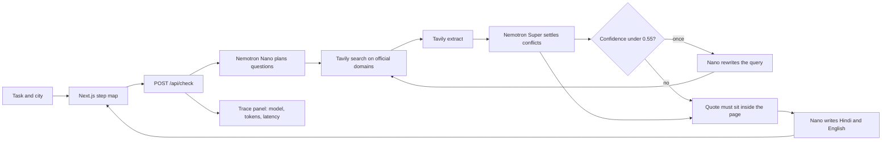

# Sarkari Speedrun

Type an Indian government task and a city — `renew passport, Patiala` — and get a step map of the cited items found: steps, documents, fees, the office or portal, processing time, and source dates or changes. Some categories may be missing.

Every item on the map cites an official page and a quote. In live mode, the quote must occur in retrieved text from that URL, ignoring case and whitespace, or the item is dropped. Numeric amounts prefixed with `₹` or `Rs` in an item's title or detail must also appear in its quote. Cached demos replay hand-copied quotes without fetching the pages again.

Quote matching does not verify that a paraphrase, translation, deadline, or local rule is correct or current. Confidence is the model's estimate, not measured accuracy; a source date/change badge does not establish recency. Open the cited page before paying or travelling. See [REVIEW.md](REVIEW.md) for the judging-criteria review and remaining gaps.

It is built for the [Nebius x NVIDIA Global AI Hackathon](https://nebiusglobalaihackathon.devpost.com). Planning, conflict-settling, and the bilingual checklist are NVIDIA Nemotron models on [Nebius Token Factory](https://tokenfactory.nebius.com/). [Tavily](https://tavily.com/) is the evidence step.

**Live demo:** [https://sarkari-speedrun.vercel.app](https://sarkari-speedrun.vercel.app)

## Verified state (October 28, 2026)

The deployed homepage and unauthenticated GitHub repository were reachable during a read-only audit. GitHub detects the public [MIT licence](LICENSE). No live task was sent to the deployment or paid provider. Provider configuration and current live model availability were not inspected.

The local audit fixes and docs below are **not deployed**. The submitted Devpost entry is reported in the project handoff, but its actual fields, track, feedback and YouTube link could not be independently inspected behind Devpost's security challenge.

## Local cached demo

```bash
npm ci
RECEIPTS_MODE=mock npm run demo
```

Open [http://127.0.0.1:41731](http://127.0.0.1:41731). Explicit mock mode prevents provider calls even if the host has live configuration. Do not use real identity documents or personal details.

1. Select **Renew a driving licence** → a cached Amritsar map with a renewal-fee quote and Parivahan source link.
2. Read the quote and bilingual checklist → these are fixture content, not freshly retrieved instructions. Check the source before acting.
3. Select **Change the address on a voter ID** → inspect the Form 8 item and the older FAQ conflict.
4. Enter `renew arms licence, Jaipur` → an empty cached map, not an invented answer and not a failed live search.
5. Open **Sample eval**, then **Score this sample** → a mock consistency score. The public eval route in this local version always uses fixtures, even on a live-configured server.

```bash
npm test
npm run eval
```

`RECEIPTS_MODE=mock npm run eval` prints a small consistency table against hand-copied official quotes shared with the fixtures. It is not an independent accuracy benchmark or a live Nemotron score.

The eval CLI reads the shell environment; it does not automatically load `.env.local`. Use `RECEIPTS_MODE=mock npm run eval` for an explicit cache-only check. For live evaluation, export both API keys and `RECEIPTS_MODE=live` in the shell first.

## Live results (Oct 26, 2026)

Historical project notes record seven live runs on Token Factory and Tavily, one each, with no manual reruns. No underlying live trace was available in the reviewed source files; these numbers are unverified historical notes, not October 28 audit measurements. The pipeline can perform an automatic low-confidence second pass.

| Task | Cited items kept | Sites cited | Time |
| --- | --- | --- | --- |
| renew passport, Patiala | 2 | passportindia.gov.in, mea.gov.in | 19 s |
| link PAN with Aadhaar, Ludhiana | 2 | incometax.gov.in, incometaxindia.gov.in | 9 s |
| renew driving licence, Amritsar | 2 | parivahan.gov.in | 17 s |
| change address on voter ID, Patiala | 1 | eci.gov.in | 12 s |
| residence certificate, Patiala | 4 | eservices.punjab.gov.in, rcms.punjab.gov.in | 20 s |
| apply for birth certificate, Jalandhar (new) | 4 | crsorgi.gov.in | 24 s |
| get income certificate, Mohali (new) | 0 | none | 12 s |

Nemotron Super proposed 20 items across these runs. 15 survived the quote check. The other 5 quoted a line that was not in the retrieved text for the cited URL, so they were dropped. When nothing survives, the map stays empty; that is what happened for the Mohali income certificate.

Each run used 4,700 to 7,100 tokens, about $0.002 at Token Factory list prices. All seven together cost about $0.014.

Previously recorded `npm run eval` live: the exact hand-copied gold line came back in 0 of 10 checks, and the same official site was cited in 5 of 10. Exact-line matching requires the gold URL and quote; citing the same site does not establish a correct answer. The score alone does not explain missing matches. Small sample, not a benchmark.

## Live limits

`/api/check` allows 5 live checks per IP per hour and 200 per UTC day. Past either limit it serves the cached demos with a note; uncached tasks stay empty. Counts are kept in memory per serverless instance, so these are soft caps, not a spend guarantee. Override them with `LIVE_PER_IP_LIMIT` and `LIVE_DAILY_LIMIT`. The local `/api/eval` fix makes the public sample cache-only; live evaluation remains an explicit operator CLI action. This fix has not been deployed.

## Where Nemotron is used

Token Factory exposes an OpenAI-compatible `POST /v1/chat/completions` API. A run with surviving items normally uses three model calls. A low-confidence second pass adds two more: Nano rewrites the query and Super checks the new evidence. Availability fallbacks can add further attempts.

| Step | Model | Token Factory id | What it does |
| --- | --- | --- | --- |
| Plan | Nemotron 3 Nano 30B | `nvidia/NVIDIA-Nemotron-3-Nano-30B-A3B` | Splits the task into sub-questions: steps, documents, fees, the counter, time, recent changes. It does not answer them. |
| Settle | Nemotron 3 Super 120B | `nvidia/nemotron-3-super-120b-a12b` | Reads the extracted pages. An official host beats a blog. A newer dated line beats an older one. Each kept item gets a confidence score and a quote copied from the page. |
| Second pass | Nano, then Super | same ids | If the weakest surviving item is under 0.55 confidence, Nano rewrites the query, Tavily searches once more, and Super checks that item once more. |
| Checklist | Nemotron 3 Nano 30B | `nvidia/NVIDIA-Nemotron-3-Nano-30B-A3B` | Writes the same checklist in Hindi and English, using only the lines that survived. |
| Availability fallback | Nemotron 3 Ultra 550B | `nvidia/Nemotron-3-Ultra-550b-a55b` | Used only when Super returns 404, 429, 500, 502, 503, or 504. |

Override the ids with `NEBIUS_NANO_MODEL`, `NEBIUS_SUPER_MODEL`, and `NEBIUS_CHECK_FALLBACK_MODEL`.

The trace panel shows the model id, prompt and completion tokens, latency, and a list-price estimate from the public catalog (Nano $0.06 / $0.24 per 1M input / output tokens, Super $0.30 / $0.90, Ultra $1 / $3). That estimate is not an invoice. Tavily credits are not included.

The source date/change badge uses a text heuristic: a year or wording such as revision, amendment, notification, extended, or “no longer”. It does not compare source dates with today. The voter-ID demo keeps an older Election Commission FAQ visible with a conflict explanation and leads with the Form 8 PDF that voters.eci.gov.in hosts.

## How Token Factory helped

One base URL and one API shape cover Nano, Super, and the Ultra fallback. Swapping the checker, or pointing the fallback at another catalog id, is an environment variable. The app does not ship a Nebius-specific SDK.

```ts
await fetch(`${NEBIUS_BASE_URL}/chat/completions`, {
  method: "POST",
  headers: {
    Authorization: `Bearer ${NEBIUS_API_KEY}`,
    "Content-Type": "application/json",
  },
  body: JSON.stringify({
    model: "nvidia/nemotron-3-super-120b-a12b",
    messages: [
      { role: "system", content: "…" },
      { role: "user", content: "…" },
    ],
  }),
});
```

Default base URL: `https://api.tokenfactory.nebius.com/v1`

## Tavily

Tavily is the page fetch, not a summary the model is allowed to trust blindly.

For each sub-question the server calls `POST https://api.tavily.com/search`, starting with service-specific domains where configured, otherwise the general list in `src/lib/config.ts`, and `time_range: "year"`. `include_answer` stays off.

If that recency filter returns nothing, the same domains are searched again without a date window, then once with no domain list. Results whose host is not `.gov.in` or `.nic.in` are dropped either way. `POST https://api.tavily.com/extract` then pulls text from the top pages and replaces the short snippet. A 401 or 403 stops the run. A failed extract keeps the search snippet.

## Cached demos

These five lines replay hand-copied quotes. They are not a live search.

| Type this | What the cache cites |
| --- | --- |
| `renew passport, Patiala` | Passport Seva fee table, re-issue steps, citizen charter clocks, MEA reply on PSP 2.0 in Punjab (26 May 2025) |
| `link PAN and Aadhaar, Ludhiana` | Income Tax Link Aadhaar help, including the ₹1,000 delayed-link fee and the 31 December 2025 enrolment-ID notice |
| `renew driving licence, Amritsar` | Parivahan fee table (Rs. 200.00 renewal), Sarathi steps, Form-1A |
| `change address on voter ID, Patiala` | Form 8 on voters.eci.gov.in, plus the older ECI FAQ kept at low confidence |
| `Punjab residence certificate, Patiala` | Punjab personnel-department form and e-Services Punjab. The cached form does not print a rupee fee, so the map does not invent one |

The cached demos omit local street addresses. Live generation is prompted to avoid unsupported addresses, but quote matching does not enforce that instruction. Dates in the cached PAN notice are the notice's dates; they are not a new extension.

## Architecture



The route streams newline-delimited JSON, so stations appear as they resolve. `/eval` checks ten fixture quotes across the five tasks. The CLI can also run live, but requires authorization for provider use; its scores do not validate meaning, jurisdiction or freshness.

## Setup

No configuration file is needed for mock mode. For an authorized live run, configure the required variables securely in the host environment. Never place real credentials in documentation, recordings or committed files.

| Variable | Required | Purpose |
| --- | --- | --- |
| `NEBIUS_API_KEY` | For live mode | Token Factory bearer token |
| `TAVILY_API_KEY` | For live mode | Tavily bearer token |
| `RECEIPTS_MODE` | No | `auto` (default), `mock`, or `live` |
| `NEBIUS_BASE_URL` | No | Defaults to Token Factory `/v1` |
| `NEBIUS_NANO_MODEL` | No | Planner and checklist model |
| `NEBIUS_SUPER_MODEL` | No | Checker |
| `NEBIUS_CHECK_FALLBACK_MODEL` | No | Ultra, if Super is unavailable |

`auto` runs live only when both keys are set.

## Deploy

`vercel.json` configures installation for the existing Vercel deployment. `render.yaml` provides an alternative web service configuration: `npm install && npm run build`, then `npm start`.

## License

[MIT](LICENSE).
