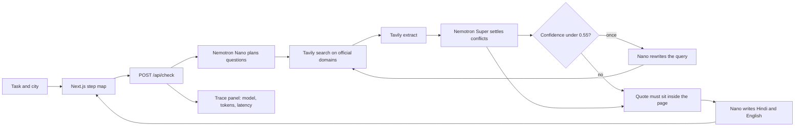

# Sarkari Speedrun

Type an Indian government task and a city — `renew passport, Patiala` — and get a step map of the cited items found: steps, documents, fees, the office or portal, processing time, and source dates or changes. Some categories may be missing.

Every item on the map cites an official page and a quote. In live mode, the quote must occur in retrieved text from that URL, ignoring case and whitespace, or the item is dropped. Selected numeric amounts prefixed with `₹`, `Rs` or `INR` in an item's title or detail must also appear in its quote. Cached demos replay hand-copied quotes without fetching the pages again.

Quote matching does not verify that a paraphrase, translation, deadline, or local rule is correct or current. Confidence is the model's estimate, not measured accuracy; a source date/change badge does not establish recency. Open the cited page before paying or travelling. See [local audit mechanics](docs/local-audit.md) for current boundaries; [REVIEW.md](REVIEW.md) preserves dated earlier reviews, not a current readiness verdict.

It is built for the [Nebius x NVIDIA Global AI Hackathon](https://nebiusglobalaihackathon.devpost.com). Planning, conflict-settling, and the bilingual checklist are NVIDIA Nemotron models on [Nebius Token Factory](https://tokenfactory.nebius.com/). [Tavily](https://tavily.com/) is the evidence step.

**Live demo:** [https://sarkari-speedrun.vercel.app](https://sarkari-speedrun.vercel.app)

## Verified state (October 28, 2026)

The deployed homepage and unauthenticated GitHub repository were reachable during a read-only audit. GitHub detects the public [MIT licence](LICENSE). No live task was sent to the deployment or paid provider. Provider configuration and current live model availability were not inspected.

The audit fixes and docs below were pushed to `master` and deployed to the live demo on October 30, 2026 (commit `bf90a4d`); the deployed `/api/check` enforces the 16 KiB request-body limit described here. The submitted Devpost entry's own fields, track, feedback and YouTube link are managed separately in Devpost.

## Local cached demo

Use Node 20.19+, Node 22.13+, or Node 24+ on Linux. This dependency update was exercised on Node 20.19.2 and npm 11.21.1; other runtime versions and platforms have not been tested here.

Clone `https://github.com/Kulraj69/sarkari-speedrun.git` (`master`) and `cd sarkari-speedrun`; it includes the fixes described here. A local review ZIP can capture source without environment files or dependencies; see [source handoff](docs/source-handoff.md). In the source directory, run:

```bash
npm ci
RECEIPTS_MODE=mock npm run demo
```

Open [http://127.0.0.1:41731](http://127.0.0.1:41731). Explicit mock mode prevents provider calls even if the host has live configuration. Do not use real identity documents or personal details.

1. Select **Renew a driving licence** → a cached Amritsar map with a renewal-fee quote and Parivahan source link.
2. Read the quote and bilingual checklist → these are fixture content, not freshly retrieved instructions. Check the source before acting.
3. Select **Change the address on a voter ID** → inspect the Form 8 item and the older FAQ conflict.
4. Enter `renew arms licence, Jaipur` → an empty cached map, not an invented answer and not a failed live search.
5. Open **Sample eval**, then **Score this sample** → a mock consistency score. The public eval route in this local version always uses fixtures, even on a live-configured server.

Copy checklist keeps both languages and the displayed citations. Clipboard denial shows an error. For failure handling, map identity, retry and routing boundaries, see [local audit mechanics](docs/local-audit.md).

Source links use a shared lexical policy in the local version: HTTP(S), a syntactically valid ASCII `.gov.in` or `.nic.in` hostname, no userinfo, and only the protocol's default port. Whitespace, control characters, backslashes and encoded hostnames are rejected rather than repaired. Rejected citation URL fields are withheld on screen and in copied source lines; card text and quotations are retained. URLs written inside prose are not scrubbed and may be autolinked by the receiving application. Accepted identifiers are retained as supplied, though browsers and providers may normalize their paths. This is not DNS, redirect, page-content or advice verification, and HTTP remains allowed. Run `npm test -- tests/source-links.test.ts` for injected-source regressions. No source link is fetched by these tests. These changes are local, not deployed.

The local browser reader now waits for EOF before accepting a terminal `done` or `error` event. Missing completion, trailing events, malformed UTF-8 and malformed JSON fail visibly; failed reads cancel the body and release its lock. `npm test -- tests/stream-lifecycle.test.ts tests/event-shape.test.ts` exercises transport and event-shape cases, split Hindi text and the actual cached HTTP streams without provider calls. Every declared event variant is checked for required fields, nested types and enum values before dispatch; unknown event types are rejected. Optional fields are checked when present, and additive unknown fields are tolerated. This is structural validation, not source authenticity, URL safety, cross-event consistency or advice validation. Browser requests have a 65-second deadline including fetch; the reader separately limits received data to 2 MiB total, 256 Ki UTF-16 code units per line and 16 KiB for HTTP error bodies. Browser scheduling can delay deadlines. These are engineering limits, not a guarantee about hosted billing or network memory allocation. Task and sample-eval requests now abort when their route effects are cleaned up (including Next's retained-route navigation) or a newer request replaces them. Late results lose UI ownership; completed requests clear their deadline timers. A cancelled retained map becomes retryable instead of remaining stuck in its running state. Clipboard results from an older run are ignored. These browser behaviors do not establish hosted provider cancellation or refunded usage. The change is local, not deployed.

```bash
npm test
RECEIPTS_MODE=mock npm run eval
```

`RECEIPTS_MODE=mock npm run eval` prints a small consistency table against hand-copied official quotes shared with the fixtures. It is not an independent accuracy benchmark or a live Nemotron score.

For the map-integrity regressions, run `npm test -- tests/map-integrity.test.ts`. This injects synthetic provider replies: duplicate IDs, rejected quotes, overflow, middle-card retries and JSON numeric overflow. It makes no live provider calls. The cached browser demo does not exercise these injected paths.

For the October 29 currency checks, run `npm test -- tests/currency-guard.test.ts tests/map-integrity.test.ts`. Supported forms include decimal amounts, Indian/Western comma grouping and Devanagari digits after the recognized prefixes. Tests cover rejection of changed amounts, selected signs, ranges, space grouping, scale suffixes, malformed expressions and truncated source expressions (numeric tokens, scale words and `/-` suffixes). Selected comma-space and spaced-decimal continuations are rejected; an ordinary new sentence such as `₹200. 2 photos are required.` still works. This is a bounded lexical check, not complete money or evidence understanding: suffix-only `999 रुपये`, number words, arbitrary prose or punctuation, paraphrases, jurisdiction and freshness remain outside its guarantee. Synthetic tests exercise both checklist languages, initial items, retries and fixture validation. The recorded cached walkthrough is not a live test of those paths.

The October 28 dependency update moves Vitest from 3.2.7 to 4.1.12 and removes the shadcn generator CLI. Its imported CSS is retained unchanged with its MIT notice in `src/styles/`. The baseline audit flagged six affected package entries; the fresh post-update `npm audit` reported zero. This is a dated registry result, not proof that the application is secure. Do not expose test/dev servers to untrusted networks. See [dependency verification](docs/dependency-verification.md) for commands, scope and remaining warnings.

The eval CLI reads the shell environment; it does not automatically load `.env.local`. Use `RECEIPTS_MODE=mock npm run eval` for an explicit cache-only check. For live evaluation, export both API keys and `RECEIPTS_MODE=live` in the shell first.

## Live evidence still needed

The October 29 local provider guard requires `finish_reason: "stop"` before using a Nemotron answer. Truncated, filtered, refused and tool-call responses are rejected, even when their text looks like valid JSON. Mixed non-text content blocks are not silently discarded. Transport/body/model-JSON parse failures use fixed error text rather than echoing provider diagnostics. `npm test -- tests/provider-boundary.test.ts` exercises these boundaries and all model stages with injected responses, not live providers. A provider omitting completion status will now fail closed; current live compatibility still needs verification.

Historical build notes describe live runs, but their underlying traces were not available in this audit. Their numerical results are not reproduced here as verified evidence. The current local tests use injected provider responses; the browser walkthrough uses cached fixtures. Neither proves live sponsor use, answer accuracy or user impact.

Before presenting live results, preserve a redacted trace showing the actual request stages, returned evidence, surviving items and failures. Score support and jurisdiction separately from exact quote matching. Do not treat model confidence or a same-site citation as a correct answer.

## Live limits

The local route reads at most 16 KiB of UTF-8 JSON and allows four seconds for upload. Oversize bodies return HTTP 413; stalled uploads return 408. Invalid JSON, disconnected uploads and tasks over 2,000 characters return 400, before consuming live allowance. The byte limit includes unused JSON fields and does not trust Content-Length.

After input parsing, the pipeline has a separate 55-second deadline, including provider response-body reads. Expiry produces an incomplete-run error locally. These budgets do not guarantee terminal delivery before the host's 60-second limit: scheduler and hosting overhead are unverified. Request disconnect and response-reader cancellation abort the shared provider signal; no further provider requests start after cancellation. The pipeline deadline also applies to operator CLI runs. Successful provider latency includes JSON body reading. Tests inject stalls and disconnects without calling providers; remote billing cancellation and hosted disconnect propagation are not verified.

`/api/check` allows 5 live checks per IP per hour and 200 per UTC day. Past either limit it serves the cached demos with a note; uncached tasks stay empty. Counts are kept in memory per serverless instance, so these are soft caps, not a spend guarantee. Override them with `LIVE_PER_IP_LIMIT` and `LIVE_DAILY_LIMIT`. The local `/api/eval` fix makes the public sample cache-only; live evaluation remains an explicit operator CLI action. This fix has not been deployed.

## Where Nemotron is used

Token Factory exposes an OpenAI-compatible `POST /v1/chat/completions` API. A run with surviving items normally uses three model calls. A low-confidence second pass adds two more: Nano rewrites the query and Super checks the new evidence. Availability fallbacks can add further attempts.

| Step | Model | Token Factory id | What it does |
| --- | --- | --- | --- |
| Plan | Nemotron 3 Nano 30B | `nvidia/NVIDIA-Nemotron-3-Nano-30B-A3B` | Splits the task into sub-questions: steps, documents, fees, the counter, time, recent changes. It does not answer them. |
| Settle | Nemotron 3 Super 120B | `nvidia/nemotron-3-super-120b-a12b` | Reads the extracted pages. An official host beats a blog. A newer dated line beats an older one. Each kept item gets a confidence score and a quote copied from the page. |
| Second pass | Nano, then Super | same ids | If the weakest surviving item is under 0.55 confidence, Nano rewrites the query, Tavily searches once more, and Super checks that item once more. |
| Checklist | Nemotron 3 Nano 30B | `nvidia/NVIDIA-Nemotron-3-Nano-30B-A3B` | Writes the same checklist in Hindi and English, using only the lines that survived. |
| Availability fallback | Nemotron 3 Ultra 550B | `nvidia/Nemotron-3-Ultra-550b-a55b` | Used only when Super returns 404, 429, 500, 502, 503, or 504. |

Override the ids with `NEBIUS_NANO_MODEL`, `NEBIUS_SUPER_MODEL`, and `NEBIUS_CHECK_FALLBACK_MODEL`.

The trace panel shows the model id, prompt and completion tokens, latency, and an observed model subtotal from the configured catalog rates (Nano $0.06 / $0.24 per 1M input / output tokens, Super $0.30 / $0.90, Ultra $1 / $3). Rates are not re-fetched at runtime. This is not an invoice or the full run cost: unrecorded failed attempts and Tavily credits are excluded. Responses with missing/invalid usage or unknown model prices have unknown cost, not zero. Token counts must be nonnegative safe integers.

Successful text responses remain in the local trace even when the planner or checker JSON is rejected. Transport failures, rejected HTTP responses and malformed/empty provider envelopes are still not recorded individually. The trace does not prove every billable attempt was captured. Mock demos have no model usage and cannot demonstrate live accounting.

The source date/change badge uses a text heuristic: a year or wording such as revision, amendment, notification, extended, or “no longer”. It does not compare source dates with today. The voter-ID demo keeps an older Election Commission FAQ visible with a conflict explanation and leads with the Form 8 PDF that voters.eci.gov.in hosts.

## How Token Factory helped

One base URL and one API shape cover Nano, Super, and the Ultra fallback. Swapping the checker, or pointing the fallback at another catalog id, is an environment variable. The app does not ship a Nebius-specific SDK.

```ts
await fetch(`${NEBIUS_BASE_URL}/chat/completions`, {
  method: "POST",
  headers: {
    Authorization: `Bearer ${NEBIUS_API_KEY}`,
    "Content-Type": "application/json",
  },
  body: JSON.stringify({
    model: "nvidia/nemotron-3-super-120b-a12b",
    messages: [
      { role: "system", content: "…" },
      { role: "user", content: "…" },
    ],
  }),
});
```

Default base URL: `https://api.tokenfactory.nebius.com/v1`

## Tavily

Tavily is the page fetch, not a summary the model is allowed to trust blindly.

For each sub-question the server calls `POST https://api.tavily.com/search`, starting with service-specific domains where configured, otherwise the general list in `src/lib/config.ts`, and `time_range: "year"`. `include_answer` stays off.

If that recency filter returns nothing, the same domains are searched again without a date window, then once with no domain list. Results whose host is not `.gov.in` or `.nic.in` are dropped either way. `POST https://api.tavily.com/extract` then pulls text from the top pages and replaces the short snippet. A 401 or 403 stops the run. A failed extract keeps the search snippet.

The local extraction join accepts one nonblank body for each exact requested URL. Duplicate results (even identical ones) retain that URL's search snippet and flag incomplete extraction; unrequested results cannot replace other evidence. The extraction limit counts distinct exact URLs, not repeated search hits. Search evidence itself is not deduplicated. This does not authenticate page content or follow redirects. Run `npm test -- tests/extraction-identity.test.ts tests/extraction-pipeline.test.ts` to exercise these cases and initial/retry prompt isolation with injected responses, without provider calls. These changes are not deployed.

## Cached demos

These five lines replay hand-copied quotes. They are not a live search.

The fixture validator checks structure, official URL hosts and selected numeric amounts, not whether every instruction follows from its quote. The cache-support tests guard specific previously observed mistakes; they are not general semantic validation. Original source snapshots and capture dates are not included, so the excerpts do not establish current requirements.

| Type this | What the cache cites |
| --- | --- |
| `renew passport, Patiala` | Passport Seva fee table, re-issue steps, citizen charter clocks, MEA reply on PSP 2.0 in Punjab (26 May 2025) |
| `link PAN and Aadhaar, Ludhiana` | Income Tax Link Aadhaar help, including the ₹1,000 delayed-link fee and the 31 December 2025 enrolment-ID notice |
| `renew driving licence, Amritsar` | Parivahan fee table (Rs. 200.00 renewal), Sarathi steps, Form-1A |
| `change address on voter ID, Patiala` | Form 8 on voters.eci.gov.in, plus the older ECI FAQ kept at low confidence |
| `Punjab residence certificate, Patiala` | Punjab personnel-department form and e-Services Punjab. The cached quotes do not establish the current fee or processing time, so those categories stay absent |

The cached demos omit local street addresses. Live generation is prompted to avoid unsupported addresses, but quote matching does not enforce that instruction. Dates in the cached PAN notice are the notice's dates; they are not a new extension.

## Architecture



The route streams newline-delimited JSON, so stations appear as they resolve. `/eval` checks ten fixture quotes across the five tasks. The CLI can also run live, but requires authorization for provider use; its scores do not validate meaning, jurisdiction or freshness.

## Setup

No configuration file is needed for mock mode. For an authorized live run, configure the required variables securely in the host environment. Never place real credentials in documentation, recordings or committed files.

| Variable | Required | Purpose |
| --- | --- | --- |
| `NEBIUS_API_KEY` | For live mode | Token Factory bearer token |
| `TAVILY_API_KEY` | For live mode | Tavily bearer token |
| `RECEIPTS_MODE` | No | `auto` (default), `mock`, or `live` |
| `NEBIUS_BASE_URL` | No | Defaults to Token Factory `/v1` |
| `NEBIUS_NANO_MODEL` | No | Planner and checklist model |
| `NEBIUS_SUPER_MODEL` | No | Checker |
| `NEBIUS_CHECK_FALLBACK_MODEL` | No | Ultra, if Super is unavailable |

`auto` runs live only when both keys are set.

## Deploy

`vercel.json` configures installation for the existing Vercel deployment. `render.yaml` provides an alternative web service configuration: `npm install && npm run build`, then `npm start`.

## License

[MIT](LICENSE).
